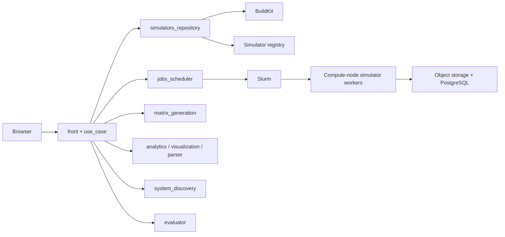

# Architecture

RTMF coordinates simulator registration, parameterized simulation batches,
and result analysis. Services can run together on one Docker host or on separate
machines. The [deployment guide](DEPLOYMENT.md) explains installation;
this page explains the responsibilities behind it.

Authentication uses Keycloak. Application services also access PostgreSQL and
object storage directly as required by their workflows; the diagram shows the
main request and execution paths rather than every connection.

## Code layout

| Path | Responsibility |
| --- | --- |
| `src/services/front` | Flask routes, forms, templates, and browser session cookies. |
| `src/services/use_case` | In-process orchestration, authorization, and handlers composed by front. |
| `src/use_case_contracts` | Shared messages, DTOs, errors, permissions, and ports. |
| `src/adapters` | REST clients, PostgreSQL repositories, object storage, identity, and Slurm integrations. |
| `src/services/<service>/composition` | Reads selected runtime JSON and wires concrete implementations. |
| `src/configuration` | Shared runtime JSON loading and environment interpolation. |
| `scripts/lib/deployment.py` | Manifest references, machine-local URLs, and Compose bundle generation. |
| `db_mgmt` | PostgreSQL schema initialization. |

The service names and published ports are listed in
[Deployment](DEPLOYMENT.md#services-and-ports). `use_case` and
`job_executor` are not separate persistent services in the shipped Compose
application. Front hosts the use-case layer; worker execution is supplied through
the simulator/cluster integration.

## Main workflow

1. A browser request reaches front, which checks the session and delegates a
   message to the use-case layer.
2. Simulator registration sends a build request to the repository. BuildKit
   builds an image from a compatible worker base, pushes it to the configured
   registry, and the repository records metadata in PostgreSQL.
3. Scheduling generates/uploads a parameter matrix and asks the scheduler to
   submit a Slurm job array. The scheduler assigns the job identity through Slurm.
4. Compute nodes run the simulator image with Apptainer, then write result
   artifacts and records to object storage/PostgreSQL.
5. Analysis and visualization services prepare the results shown in the browser.
   Evaluator and System Discovery provide additional workflows on those services.

A job contains array tasks (sub-jobs). Address a sub-job with both `job_id` and
`sub_job_id`. Session state is currently process-local to front; the default
installation uses a single frontend instance.

## Configuration boundary

The deployment manifest is an authoring format. Rendering expands shared
references into separate runtime JSON files and produces one Compose project
for the services installed on a machine. Secret placeholders remain unresolved
until container startup. Each process loads only its own configuration section;
front also loads the use-case section.

Compose handles local containers and the BuildKit sidecar. Existing database,
storage, identity, registry, and cluster systems are separate prerequisites.
See [Configuration](CONFIGURATION.md) for the complete manifest contract.
